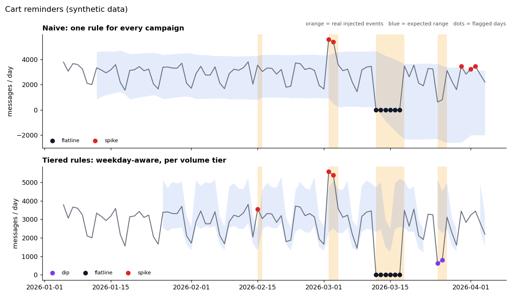

# Message Trend Anomaly Detector

Spot broken or misbehaving message campaigns from daily send volumes, without
someone eyeballing charts every morning.

> **Synthetic data only.** This is a clean-room rebuild of an idea I built at work.
> It uses made-up campaigns and no company data, code or names.



## The problem

Teams that send messages to customers (order updates, reminders, newsletters)
need to know quickly when a campaign breaks: it stops sending, suddenly
doubles, or quietly drops. Checking volume charts by hand is slow, and easy
rules ("alert on anything unusual") create so many false alarms that people
stop trusting them.

## What it detects

Every rule works on **daily send counts** and is judged against what is normal
**for that weekday**, since weekends are naturally quieter.

| Rule | Fires when |
|---|---|
| **Flatline** | volume is zero for more than 2 days in a row |
| **Spike** | volume is well above the weekday average (default +50%) |
| **Dip** | volume is 3 standard deviations below the weekday average |
| **Cadence** (very low volume only) | the send *frequency* changes: a long gap since the last send, or a burst of sends that is too frequent |

**Volume tiers.** Campaigns are grouped by average daily volume, and each group
has its own tolerance, because a 4,000-message swing means something very
different for a 50,000/day campaign than for a 200/day one.

| Tier | Avg daily volume | Rules used |
|---|---|---|
| high | 10,000+ | spike +30%, dip 3 SD (and at least 15% lower), flatline 3 days |
| medium | 1,000 to 10,000 | spike +50%, dip 3 SD (at least 20% lower), flatline 3 days |
| low | 100 to 1,000 | spike +60%, dip 3 SD (at least 30% lower), flatline 3 days |
| very low | under 100 | cadence rules instead of volume rules (zero days are normal here) |

Thresholds live in `src/detector.py` (`DEFAULT_TIERS`) and can be changed live in the demo app.

## Results

Scored against injected, labelled anomalies on **100 unseen synthetic datasets**
(8 campaigns x 90 days each, about 28 real events per dataset). The thresholds were
tuned on a different set of seeds, and the numbers below are from seeds the
detector never saw.

| Detector | Alerts / dataset | False alerts / dataset | Precision | Recall |
|---|---|---|---|---|
| Naive (one rule for every campaign) | 29.9 | 10.0 | 0.67 | 0.78 |
| **Tiered, weekday-aware rules** | 28.3 | **2.1** | **0.93** | **0.95** |

That is about **5x fewer false alerts** while catching more real problems.

Recall by event type (tiered): flatline 1.00, cadence burst 1.00, spike 0.94,
dip 0.92, cadence gap 0.88. The naive detector catches only 34% of dips.

**Why the naive version struggles**
- Weekday swings inflate its standard deviation, so real dips hide inside the "normal" range.
- Earlier outages drag its 28-day average down, so healthy days look like spikes.
- It treats every zero day as a flatline, which is wrong for low-volume campaigns that only send every few days.

The tiered detector fixes these by comparing each day with the same weekday, leaving
already-flagged days out of its baseline, pooling day-to-day variation across all
weekdays for a steadier SD, and using cadence rules for sporadic campaigns.

**Known limits**
- It only works on synthetic data here. Real data is messier (holidays, planned campaign launches), so thresholds would need tuning per business.
- Cadence gaps are the hardest case: a weekly campaign right after a burst has little clean history, so a skipped send can go unnoticed (88% recall).
- Rules are fixed. The natural next step is learning thresholds from history or a model trained on labelled incidents.

## Run it

```bash
git clone https://github.com/Mrunmayee1/message-trend-anomaly-detector.git
cd message-trend-anomaly-detector
python -m venv .venv && source .venv/bin/activate   # Windows: .venv\Scripts\activate
pip install -r requirements.txt

streamlit run app.py          # interactive demo
python -m src.evaluate        # reproduce the results table
python -m pytest              # 14 unit tests
```

The demo lets you switch datasets, pick a campaign, compare naive vs tiered rules,
and move the thresholds for each tier to see alerts and precision change instantly.

## Project layout

```
app.py                 Streamlit demo
src/generate_data.py   synthetic campaigns + injected, labelled anomalies
src/detector.py        tiered detector, naive baseline, alert grouping
src/evaluate.py        precision / recall against the ground truth
tests/                 unit tests for each rule
docs/make_figure.py    builds the chart above
```

## How I built it

I used Claude as a pair programmer: I described the rules and the tier idea, Claude drafted
the generator, detector and tests, and I reviewed the output and pushed back on it.
Two examples of that loop:

- My first version of the "naive vs tiered" tests assumed weekend dips caused the naive
  detector's false alarms. The tests failed. Digging in showed the real causes (inflated
  SD, polluted baselines), so the tests and this README now describe what actually happens.
- Early versions flagged normal scheduled sends as part of a burst. Fixing the burst
  logic cut false alerts on the very low volume campaigns.

## Background

The original is a tool I built at work with Claude: a working prototype in a day, then
refined with the team. It watches message volume trends and saves around 1.5 hours of
manual checking each day.

## License

MIT
